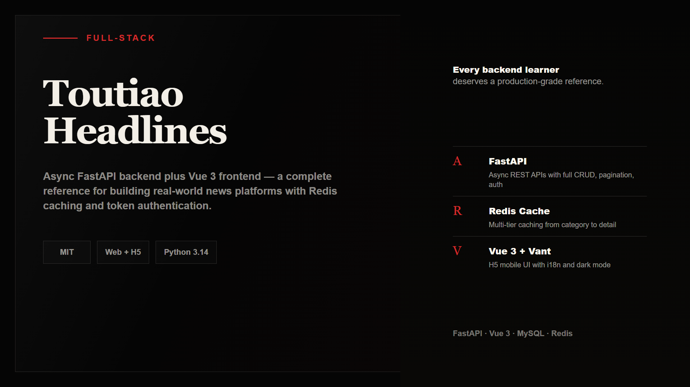
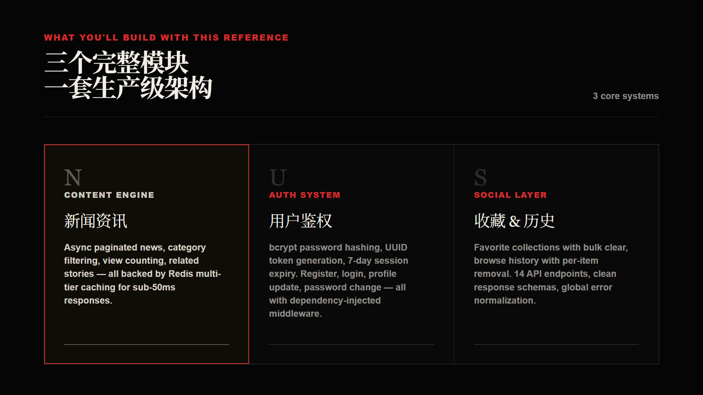

<div align="center">

# Toutiao Headlines

**Full-stack news platform — async FastAPI + Vue 3 + Redis, built as a production-grade learning reference**



[](./LICENSE)
[](https://www.python.org/)
[](https://fastapi.tiangolo.com/)

</div>

---

## 这是什么

一个完整的"头条"风格资讯平台，前后端分离，覆盖从数据库到 H5 移动端的全部链路——异步 ORM、Redis 多级缓存、全局异常处理、Token 鉴权中间件、i18n 国际化。

它既是一个能跑的头条 App，也是一份写给后端学习者的工程参考。

## 为什么需要它

大多数 FastAPI 教程停在"写一个 CRUD 接口"。这个项目把完整的链路推到了可以上线运行的状态：

- **异步到底**：SQLAlchemy async engine + aiomysql + redis.asyncio，链接池管理、事务提交、异常回滚都在依赖注入中处理
- **缓存分层**：分类 7200s、列表 1800s、详情 300s、相关推荐 1800s，每一层的过期策略独立
- **鉴权闭环**：bcrypt 密码哈希 → UUID Token 签发 → 7 天过期 → 中间件解析 → 路由守卫
- **前端完整**：14 个页面，路由懒加载、Pinia 持久化状态、axios 拦截器、暗色模式跟随系统

## 你会得到什么



| 模块 | 说明 |
|------|------|
| **新闻内容引擎** | 分类列表、分页查询、详情+浏览量自增、相关推荐 — 全部走 Redis 缓存，响应 < 50ms |
| **用户鉴权系统** | 注册/登录/信息修改/密码变更，bcrypt + UUID Token，7 天 session，Dependency Injection 鉴权 |
| **收藏 & 浏览历史** | 收藏增删查清、历史逐条/批量删除，统一 JSON 响应 + 全局异常兜底 |
| **H5 移动端** | Vue 3 + Vant 4 + Pinia + vue-i18n，14 个页面，路由守卫，系统暗色模式跟随 |

## 工作方式

后端是经典的四层架构：**Router** 管协议与参数校验，**CRUD** 只管 SQL 查询（Redis 缓存逻辑也在这一层），**Models** 描述表结构，**Schemas** 约束 Pydantic 输入输出。所有接口返回统一的 `{ code, message, data }` 格式，异常被全局中间件兜底捕获而不抛到客户端。

前端使用 Vant 移动端组件库 + Pinia 状态管理 + axios 请求封装，页面懒加载，已登录路由有全局守卫。

```
toutiao/
├── toutiao_backend/        ← FastAPI 后端
│   ├── main.py             # 入口：CORS + 路由挂载 + 异常注册
│   ├── config/             # 数据库引擎 / Redis 连接
│   ├── models/             # SQLAlchemy ORM
│   ├── schemas/            # Pydantic 请求/响应模型
│   ├── crud/               # 数据访问 + 缓存层
│   ├── routers/            # API 路由
│   ├── cache/              # Redis 缓存策略
│   └── utils/              # 响应、鉴权、异常处理
└── toutiao-frontend/       ← Vue 3 前端
    └── src/
        ├── views/          # 14 个页面组件
        ├── components/     # NewsItem、TabBar 等
        ├── store/          # Pinia 状态管理
        ├── router/         # 路由 + 守卫
        ├── i18n/           # 中英文语言包
        └── config/         # API 配置
```

## 快速开始

**环境要求**：Python 3.14+、MySQL 8、Node.js 18+、Redis

```bash
# 1. 克隆 + 初始化数据库
git clone https://github.com/Parker-Gui/toutiao-fastapi
mysql -u root -p < toutiao_backend/database.sql

# 2. 启动后端
cd toutiao_backend
uv sync
uv run uvicorn main:app --reload --host 127.0.0.1 --port 8000

# 3. 启动前端（新终端）
cd toutiao-frontend
npm install
npm run dev

# 4. 可选：一键脚本（需先启动 Redis）
# . .\start.ps1
```

启动后访问：

| 服务 | 地址 |
|------|------|
| API 文档 (Swagger) | http://127.0.0.1:8000/docs |
| 前端页面 | http://localhost:5173 |
| 健康检查 | http://127.0.0.1:8000/ |

## API 概览

统一响应格式 `{ "code": 200, "message": "success", "data": {...} }`

| 方法 | 路径 | 说明 | 需鉴权 |
|------|------|------|--------|
| `GET` | `/api/news/categories` | 新闻分类列表 | — |
| `GET` | `/api/news/list` | 新闻列表（分页 + 分类筛选） | — |
| `GET` | `/api/news/detail` | 新闻详情 + 浏览量 + 相关推荐 | — |
| `POST` | `/api/user/register` | 用户注册 | — |
| `POST` | `/api/user/login` | 用户登录 | — |
| `GET` | `/api/user/info` | 获取用户信息 | ✓ |
| `PUT` | `/api/user/update` | 更新用户资料 | ✓ |
| `PUT` | `/api/user/password` | 修改密码 | ✓ |
| `POST` | `/api/favorite/add` | 添加收藏 | ✓ |
| `DELETE` | `/api/favorite/remove` | 取消收藏 | ✓ |
| `GET` | `/api/favorite/check` | 检查收藏状态 | ✓ |
| `GET` | `/api/favorite/list` | 收藏列表 | ✓ |
| `DELETE` | `/api/favorite/clear` | 清空收藏 | ✓ |
| `POST` | `/api/history/add` | 添加浏览记录 | ✓ |
| `DELETE` | `/api/history/remove` | 删除单条记录 | ✓ |
| `GET` | `/api/history/list` | 浏览历史列表 | ✓ |
| `DELETE` | `/api/history/clear` | 清空历史 | ✓ |

## 技术选型笔记

| 决策 | 原因 |
|------|------|
| **pwdlib 替代 passlib** | passlib 已停止维护，Python 3.14 移除 `crypt` 模块后直接报错 |
| **redis.asyncio** | 与 FastAPI 的 async 风格保持一致，避免同步阻塞 |
| **Pydantic `model_validate` 做 camelCase 转换** | 列表接口返回 ORM 对象的 snake_case 字段，通过 Pydantic alias 转为前端期望的 camelCase |
| **Token 从 `Authorization` 头取最后一段** | 兼容 `Bearer <token>` 和直接传 token 两种方式 |
| **npm 而非 pnpm** | 开发环境 pnpm 未全局安装，npm run dev 效果完全相同 |

## 许可证

[MIT](./LICENSE)

## 关于作者

学习路线记录：[Parker-Gui](https://github.com/Parker-Gui) · 项目地址：[toutiao-fastapi](https://github.com/Parker-Gui/toutiao-fastapi)